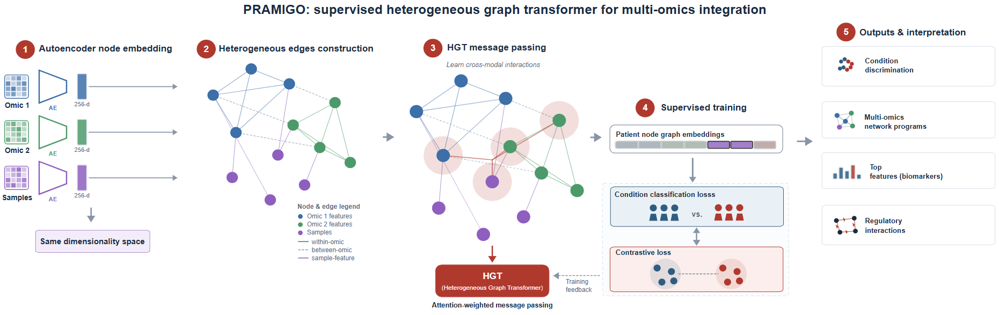

# PRAMIGO: A Heterogeneous Graph Transformer approach to target multi-omic integrated programs

<p align="center">
  
</p>

PRAMIGO builds a heterogeneous graph over **samples and an arbitrary number of omic layers**, trains a Heterogeneous Graph Transformer (HGT) on it, and returns embeddings, attention-based interpretability, and cluster-level "programs" of co-regulated features — all from a single command.

> This version of **PRAMIGO** generalizes the pipeline from a fixed 2-omic CLI (`--omic1_path`/`--omic2_path`) to an arbitrary-length list of omics, driven by a small YAML/JSON manifest (`--omics_manifest`). The original 2-omic flags still work unchanged (see [Input data](#-input-data) below) — nothing about the 2-omic path changes for existing users.

---

## 📥 Installation

```bash
git clone https://github.com/iclemente99/PRAMIGO
cd PRAMIGO

curl -LsSf https://astral.sh/uv/install.sh | sh   # once, to install uv
uv venv hgt_env --python 3.8
source hgt_env/bin/activate                        # macOS / Linux
# hgt_env\Scripts\activate                          # Windows (PowerShell/cmd)
uv pip install -r env/biomixhgt_env.txt
```

That's it — no manual dependency wrangling beyond this.

---

## 📊 Input data

PRAMIGO_gen expects a metadata TSV plus **either** an `--omics_manifest` (any number of omics) **or** the legacy `--omic1_path`/`--omic2_path` pair (exactly 2 omics).

| File | Required columns / shape |
|---|---|
| `--metadata_path` | Samples as rows, with at least `ID` (sample identifier) and `CONDITION` (group label) |
| each omic file | Features × samples, `ID` column first (e.g. gene expression, metabolomics, methylomics, ...) |

> ⚠️ **The omic matrices must already be filtered and normalized.** PRAMIGO does **not** perform any filtering, batch correction, or normalization of its own — it consumes the matrices as-is and builds the correlation graph directly from them. Feed it raw or poorly-normalized data and the feature-feature correlation graph (and everything downstream of it) will reflect that noise. A standard choice is per-feature (row-wise) z-scoring after your usual QC/filtering pipeline — see [Simulated toy data](#-simulated-toy-data) below for a worked example of exactly this format. 

> As a general recommendation, we suggest using a **row-wise normalized matrix restricted to the significantly different omic features** identified between groups within each modality.

### The omics manifest (`--omics_manifest`)

For anything beyond 2 omics, point `--omics_manifest` at a YAML or JSON file listing however many omic layers your run needs instead of adding more `--omicN_path`-style flags:

```yaml
topology: full              # 'full' (default) or 'star' - see Topology below
sample_mode: intersection   # 'intersection' (default) or 'union' - see Sample coverage below
omics:
  - name: transcriptomics
    path: ./data/rnaseq.tsv
    rate: 1.0                # optional, accepted for compatibility but ignored - training always uses every feature
    corr_cutoff: 0.7          # optional, defaults to 0.7 - feature-feature correlation threshold for this omic
    kind: transcriptomics     # optional modality tag, defaults to `name` - see "Same omic twice" below
  - name: methylomics
    path: ./data/methyl.tsv
    corr_cutoff: 0.6
  - name: metabolomics
    path: ./data/metab.tsv
```

`name` must be unique across the manifest — it becomes that omic's node type, output subfolder (`<result_dir>/<name>/`), and plot legend label, so keep it short and filesystem-safe. `topology` and `sample_mode` can also be set at the top level of the manifest as shown, or overridden from the command line with `--topology`/`--sample_mode` (the CLI flag always wins if both are given).

If `--omics_manifest` is omitted, `--omic1_path`/`--omic2_path` (plus their `--omic1_rate`/`--omic2_corr_cutoff`/etc. siblings) are automatically wrapped into an equivalent 2-entry manifest, so every existing 2-omic command still works unchanged.

### Topology: `full` vs. `star` (`--topology`)

Controls whether omic layers connect **directly to each other**, in addition to connecting through sample nodes:

- **`full` (default, matches original PRAMIGO behavior):** every pair of omics gets its own direct feature-feature correlation graph (a specific gene can be wired straight to a specific metabolite). Cost grows as O(k²) in the number of omics — fine for 2-4 omics, worth watching beyond that.
- **`star`:** omics only ever connect through sample nodes, never directly to each other. Cost is O(k) in the number of omics, at the price of losing that direct cross-omic co-regulation edge.

```bash
python src/biomix_hgt.py --omics_manifest manifest.yaml --metadata_path ... --result_dir ... --topology star
```

### Sample coverage: `intersection` vs. `union` (`--sample_mode`)

Controls which samples are kept when not every sample has data in every omic:

- **`intersection` (default, matches original PRAMIGO behavior):** complete-case — only samples present in the metadata *and every single omic* survive. With many omics, this can shrink the usable cohort fast (every extra omic multiplies the chance a sample is missing at least one layer).
- **`union`:** keep any sample present in the metadata and *at least one* omic. A sample missing a given omic's data gets that omic's feature block zero-filled (so every omic matrix still has one column per kept sample) and, critically, gets **no graph edges** of that omic-sample relation type for that sample — the missingness is carried structurally by the graph (no edges), not by an imputed value pretending to be real data.

```bash
python src/biomix_hgt.py --omics_manifest manifest.yaml --metadata_path ... --result_dir ... --sample_mode union
```

### Same omic twice (`kind`)

Tagging two manifest entries with the same `kind` (e.g. two transcriptomics files from different platforms/cohorts of the *same* patients) groups them in reports/plots without merging them into one feature space — each is still its own node type/file. This is safe for the same-cohort, two-platform case. Merging **different cohorts'** data of the same modality is a separate multi-cohort/batch-effect problem (differing sample sets, potential feature-ID mismatches, and a real risk of the graph picking up cohort identity instead of biology) that PRAMIGO_gen does not attempt to solve automatically — do any needed harmonization/batch-correction upstream before feeding the files in.

---

## 🧪 Training and evaluation protocol

- **Held-out samples.** Before training, samples are split per condition (stratified) into train / val / test (`--val_ratio`, `--test_ratio`, default 15% / 15%, at least one sample per condition in each when the condition has ≥ 3 samples). The split is saved to `model/sample_split.csv`.
- **Training subgraphs.** `--n_batch` subgraphs, as in DeepMAPS, each holding a random third of the **training** samples. Validation and test samples never enter a training subgraph, so the loss and optimizer never see their labels. The validation loss is computed on the validation samples every epoch, and the model from the epoch with the **lowest validation loss** is the one saved and used for inference and interpretability (marked on `training_loss_components.pdf`). The reported metrics (`confusion_matrix.pdf`, ROC curves, per-class performance) use the test samples only.
- **Same graph in training and inference.** Every graph the model sees, whether a training subgraph, the validation graph or an inference batch, is built by one function: **all** feature nodes with all their feature–feature edges, plus a subset of sample nodes. Sample nodes only receive messages. So each node has exactly the same neighbourhood (and the same attention softmax) during training as at inference.
- **What is *not* held out.** The unsupervised preprocessing (the autoencoders and the KNN/correlation masks) is fitted on the omic values of all samples, without labels. This is the usual transductive setting for graph models: no labels leak, but held-out samples' omic values do shape the feature embeddings and the graph.

## 🚀 Running it

### From the command line

Legacy 2-omic flags (unchanged from PRAMIGO):

```bash
python src/biomix_hgt.py \
  --metadata_path "./data/EGAS00001001746/EGAS00001001746_metadata_CLL.tsv" \
  --omic1_path "./data/EGAS00001001746/EGAS00001001746_transcriptomics.tsv" \
  --omic2_path "./data/EGAS00001001746/EGAS00001001746_methylomics.tsv" \
  --result_dir "./data/EGA_biomix"
```

Or with a manifest (any number of omics — see [The omics manifest](#the-omics-manifest---omics_manifest) above):

```bash
python src/biomix_hgt.py \
  --metadata_path "./data/EGAS00001001746/EGAS00001001746_metadata_CLL.tsv" \
  --omics_manifest "./data/EGAS00001001746/manifest.yaml" \
  --result_dir "./data/EGA_biomix"
```

### From a Python script

`src/biomix_hgt.py` is a standalone script (not a package with an importable API), so the supported way to drive it from Python is the same way it's launched from the shell — via `subprocess`, pointed at whatever interpreter has the `hgt_env` dependencies installed:

```python
import subprocess, sys

subprocess.run([
    sys.executable, "src/biomix_hgt.py",
    "--metadata_path", "./data/EGAS00001001746/EGAS00001001746_metadata_CLL.tsv",
    "--omic1_path", "./data/EGAS00001001746/EGAS00001001746_transcriptomics.tsv",
    "--omic2_path", "./data/EGAS00001001746/EGAS00001001746_methylomics.tsv",
    "--result_dir", "./data/EGA_biomix",
], check=True)
```

This is useful for calling PRAMIGO as one step in a larger Python pipeline (e.g. looping over hyperparameters or datasets).

### Resuming a training run

Training checkpoints itself every epoch by default (model, optimizer, scheduler, RNG state, and full loss history), so a killed or time-limited run isn't wasted:

```bash
python src/biomix_hgt.py --resume \
  --metadata_path ... --omic1_path ... --omic2_path ... \
  --result_dir "./data/EGA_biomix" --epoch 200
```

`--resume` picks up from `<result_dir>/model/checkpoint_latest.pt` and continues until `--epoch`. If no checkpoint exists yet, it just starts fresh. If the checkpoint already reached `--epoch`, it exits immediately rather than doing wasted work. The checkpoint records the train/val/test sample split, and `--resume` refuses to continue if the current run would produce a different split (or if the checkpoint predates the split), since that would leak held-out samples into training.

### Key arguments

| Argument | Default | Meaning |
|---|---|---|
| `--epoch` | 100 | Number of training epochs |
| `--n_batch` | 32 | Number of training subgraphs per epoch (DeepMAPS-style) |
| `--val_ratio` | 0.15 | Fraction of samples per condition held out for validation |
| `--test_ratio` | 0.15 | Fraction of samples per condition held out for the reported test metrics |
| `--n_hid` | 128 | HGT hidden dimension |
| `--ae_n_hid` | 256 | Autoencoder hidden dimension (feature reduction step) |
| `--n_heads` | 8 | Attention heads |
| `--n_layers` | 2 | Number of HGT layers |
| `--lr` | 0.0001 | Learning rate |
| `--omics_manifest` | none | YAML/JSON manifest listing an arbitrary number of omics (takes precedence over `--omic1_path`/`--omic2_path`) |
| `--topology` | `full` | `full` (every omic pair gets direct edges) or `star` (omics only connect through samples) |
| `--sample_mode` | `intersection` | `intersection` (complete-case) or `union` (partial coverage, missing omics get no edges) |
| `--omic1_corr_cutoff`, `--omic2_corr_cutoff` | 0.7 | [legacy 2-omic mode] Correlation threshold for building each omic's feature-feature graph edges — use `corr_cutoff:` per-omic in `--omics_manifest` instead |
| `--target_class` | `disease` | Condition(s) whose programs are built, case-insensitive; several allowed (`--target_class PTB PTB_DM`) or `all`. If no condition is called `disease` and the flag isn't given, every condition gets its own programs |
| `--network_features_per_omic` | 100 | Top features per omic drawn in `network_multiomic.pdf`; several values give one page each (`--network_features_per_omic 10 20 50 100`) |
| `--leiden_resolution` | 1.5 | Resolution for Leiden clustering of the program feature graph |
| `--leiden_min_cluster_size` | 3 | Minimum cluster size to keep in the cluster-network plots |
| `--cuda` | 1 | **`0` runs on GPU 0; any other value runs on CPU** |
| `--resume` | off | Resume from `<result_dir>/model/checkpoint_latest.pt` |
| `--checkpoint_every` | 1 | Save a resumable checkpoint every N epochs |

Run `python src/biomix_hgt.py --help` for the complete list, including reduction method, dropout, optimizer choice, and regularization weight.

---

## 📁 Outputs

Everything is written under `--result_dir`, organized into subfolders:

| Folder | Contents |
|---|---|
| `model/` | `checkpoint_latest.pt` (resumable training state), the final trained model, and `sample_split.csv` (which samples were train / val / test) |
| `loss/` | Per-epoch CSVs (the loss is `0.3·CE + 0.7·cosine`): training total / cross-entropy / cosine (means over that epoch's training subgraphs) and validation loss (held-out validation samples) |
| `<omic_name>/` (one per omic, named after its manifest `name` — `omic1/`/`omic2/` in legacy 2-omic mode), `sample/` | Learned embedding matrices for each node type |
| `embeddings/` | Classifier-head embeddings at each hidden layer (128 / 64 / 32-dim) plus final class embeddings |
| `att/` | The main interpretability output: an edge table (`<run>.csv`) and a node table (`<run>_node_attribution.csv`) — see [Interpretability](#-interpretability) |
| `plots/` | Core visualizations (see below), always generated |
| `supplementary/` | Additional diagnostic plots, always generated |

**Core visualizations (`plots/`):**
- `training_loss_components.pdf` — total/validation loss plus loss components over training
- `confusion_matrix.pdf` — classification performance on the held-out **test samples**; `classification_metrics.csv` has accuracy / F1 / ROC-AUC for the train, val and test samples separately and for all samples together (`all`; optimistic, since it includes training samples)
- `interpretability_nodes_attention.pdf` — top 10 features per omic and overall, ranked by attribution, plus the cumulative attribution curve
- `embeddings_evaluations.pdf` — embedding quality diagnostics
- `network_interactive.html` — interactive, browsable version of the integrated graph
- `network_multiomic.pdf` — the same attention network as a print-ready figure, one page per `--network_features_per_omic` value: the top-N features per omic (by `Attribution`) and every sample; edges = HGT attention relative to uniform (`attention_ratio` = α × in-degree, mean of heads and layers), kept when ≥ the 80th percentile of their edge type in the largest network (so smaller pages are subgraphs of the largest). Hairline edges coloured by omic (grey between two omics), samples as condition-coloured rings, shaded modules (connected components), 5 labelled features per omic and module. `network_interactive.html` uses the same edge weight.
- `programs_<condition>/` (one folder per `--target_class`): `leiden_clusters_composition.csv`, `leiden_cluster_network.pdf`, `leiden_cluster_subgraphs.pdf`, `leiden_program_activity_scores.csv`, `leiden_program_activity_report.pdf` — that condition's multi-omic programs (see [Programs](#-programs-per-target-condition)). These only appear if at least one cluster meets `--leiden_min_cluster_size`; on very small graphs it's normal for no cluster to form.

**Supplementary plots (`supplementary/`):** learning-rate schedule, loss-component share over time, ROC curves, per-class performance, attribution concentration/distribution by omic layer, embedding separability (silhouette) and PCA scree, plus a hub-node network figure. `supplementary/programs_<condition>/` adds, per target condition: `attribution_specificity_scatter.pdf` (attr vs attr_off for every feature), program sizes, inter-program connectivity, member correlation, and program activity heatmaps.

---

## 🧪 Simulated toy data

`src/simulate_data.py` generates a small synthetic dataset for quickly exercising the whole pipeline without needing real data — useful for smoke-testing an install or a code change in seconds rather than minutes:

```bash
python src/simulate_data.py
```

This writes to `data/simulated_toy/`:
- **9 samples** across **3 condition groups** (3 patients each)
- **2 omic layers, 20 features each** — 10 differentially-expressed (DE) marker features per omic (each tied to exactly one group via a fixed mean shift) and 10 pure-noise features
- Every matrix is written **already row-wise (per-feature) z-scored** — exactly the normalized format `biomix_hgt.py` expects (see [Input data](#-input-data) above)
- `simulated_ground_truth.tsv` records which features are DE and which group they mark, so downstream attention/interpretability output can be checked against a known answer

Run PRAMIGO on it directly:

```bash
python src/biomix_hgt.py \
  --metadata_path data/simulated_toy/simulated_metadata.tsv \
  --omic1_path data/simulated_toy/simulated_omic1.tsv \
  --omic2_path data/simulated_toy/simulated_omic2.tsv \
  --result_dir data/simulated_toy_result \
  --epoch 4 --n_batch 2 --n_hid 8 --ae_n_hid 8 --n_heads 2 --n_layers 2
```

### Test suite

`src/test_biomix_pipeline.py` is an end-to-end integration test built on this simulated data:

```bash
pytest src/test_biomix_pipeline.py -v -s
```

It provisions a fresh `uv` environment from `env/biomixhgt_env.txt`, then runs the full pipeline — loading, training (including resume-from-checkpoint), output saving, and visualization — for both a 2-group and a 3-group condition setup, and checks that every expected file above gets created. It's a slow test (a few minutes even on toy-sized data), so it's meant for validating a setup or a code change, not for a tight edit/test loop. It uses pytest's `tmp_path`/`tmp_path_factory` fixtures for its result directories, so outputs from a plain `pytest` run land in your OS temp folder, not the repo — run the direct command above (or pass `--result_dir` to your own invocation) if you want to keep and inspect the plots.

---

## ✍️ Citation & Acknowledgements

This work was developed through the BiomiX consortium (https://github.com/IxI-97/BiomiX). Please cite accordingly if used in academic research.

> Iñigo Clemente-Larramendi, Jessica Gliozzo, Lourdes Velo-Suárez, Ozvan Bocher, Nathan Foulquier, María Hernández-Valladares, Marc-André Legault, Divi Cornec, Christophe Jamin, Alberto Gil-de-la-Fuente, Álvaro Fernández-Ochoa and Cristian Iperi. BiomiX 3.0: A user-friendly platform for democratized multi-omics integration with graph-based learning. bioRxiv. https://doi.org/10.64898/2026.09.22.753185

## 🖥️ Maintainers

Iñigo Clemente Larramendi — inigo.clementelarramendi@univ-brest.fr
